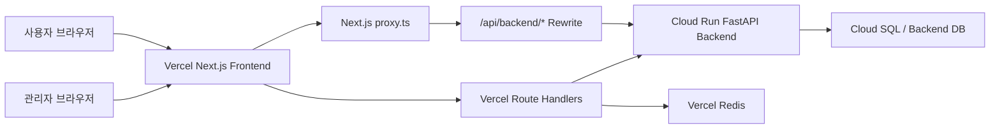

# reservation.io 프론트엔드 시스템 문서 및 보안 점검 기록

작성일: 2026-06-22  
대상 저장소: `reservation.io-frontend`  
런타임: Next.js App Router, Vercel, Cloud Run API, Vercel Redis

이 문서는 현재 프론트엔드와 Vercel 계층의 전체 구조, API 연동 방식, 운영 환경변수, 보안 판단, 취약점 보강 사항을 한 문서만 보고 다시 구현할 수 있도록 정리한 기준 문서이다.

## 1. 시스템 목표

reservation.io는 포켓몬 카드 등 한정 판매 상품 예약을 모바일 우선으로 처리하는 예약 시스템이다. 사용자는 카카오 로그인 후 판매 날짜, 판매 일정, 상품, 방문 시간을 선택해 예약한다. 관리자는 판매 일정 생성, 예약 현황 조회, 방문 확인, 노쇼/예약 제한, 안내문 관리를 수행한다.

현재 프론트엔드가 담당하는 핵심 책임은 다음과 같다.

- 사용자 및 관리자 화면 제공
- Cloud Run 백엔드 API 호출
- Vercel Rewrite를 통한 백엔드 Reverse Proxy
- Vercel Proxy와 Redis 기반 요청 제한
- Vercel Function과 Redis 기반 예약 대기열
- 예약 생성/수정/취소 요청의 비동기 처리 UX
- QR/수동 방문 확인 UX
- 개인정보 처리방침 Markdown 조회 및 렌더링

최종 재고 차감, 예약 중복 방지, 예약 제한, 방문 완료, 노쇼 처리 같은 비즈니스 불변식은 Cloud Run 백엔드와 DB 트랜잭션이 최종 책임을 진다. 프론트엔드는 이를 사용자에게 직관적으로 안내하고, 과도한 요청을 줄이며, Vercel 계층에서 1차 방어를 수행한다.

## 2. 전체 아키텍처



경로별 흐름은 다음과 같다.

- 일반 조회 API: 브라우저 -> `/api/backend/*` -> Vercel Proxy rate limit -> Next Rewrite -> Cloud Run
- 예약 생성: 브라우저 -> `/api/reservation-requests` -> Vercel waiting room -> Cloud Run `/reservation-requests`
- 예약 수정/취소: 브라우저 -> `/api/reservations/{reservation_uuid}` -> Vercel waiting room -> Cloud Run `/reservations/{reservation_uuid}`
- 대기열 반납: 브라우저 -> `/api/waiting-room/release` -> Redis lease/active/queue 제거
- 판매일 열기/닫기: 브라우저 -> `/api/admin/schedule-dates/{sale_date}/{open|close}` -> Cloud Run 상태 변경 -> Redis `wr:open:{sale_date}` 동기화
- 개인정보 처리방침: 브라우저 -> `/static/personal.md` -> Cloud Run `/static/personal.md`

## 3. 주요 파일 지도

| 파일 | 역할 |
| --- | --- |
| `next.config.ts` | `/api/backend/:path*`를 `API_REWRITE_ORIGIN`으로 Rewrite |
| `src/proxy.ts` | Redis Sliding Window Counter rate limit |
| `src/lib/api.ts` | 브라우저 API 클라이언트, 토큰 첨부, 오류 정규화, 중복 요청 UX 방어 |
| `src/lib/auth.ts` | 사용자/관리자 토큰 및 사용자 정보 localStorage 관리 |
| `src/lib/types.ts` | 프론트엔드 공용 타입 |
| `src/lib/server/reservationGateway.ts` | Vercel Function 공용 backend forwarder, waiting room, Redis 동기화 |
| `src/lib/reservationRequests.ts` | 예약 요청 idempotency key, polling, waiting room release |
| `src/app/api/reservation-requests/route.ts` | 예약 생성 gateway |
| `src/app/api/reservations/[reservation_uuid]/route.ts` | 예약 수정/취소 gateway |
| `src/app/api/waiting-room/release/route.ts` | waiting room lease 반납 |
| `src/app/api/admin/schedule-dates/[sale_date]/[action]/route.ts` | 판매일 open/close와 Redis 동기화 |
| `src/app/static/personal.md/route.ts` | 백엔드 개인정보 처리방침 Markdown proxy |
| `src/components/common/MarkdownViewer.tsx` | Markdown 렌더링 보안 정책 |
| `src/components/common/WaitingRoomModal.tsx` | 대기열 안내 모달 |
| `src/app/schedules/page.tsx` | 사용자 예약 가능 일정 화면 |
| `src/app/reservations/page.tsx` | 사용자 예약 현황, 수정, 취소 |
| `src/app/visit/page.tsx` | 사용자 방문 확인증 QR/수동 코드 |
| `src/app/profile/page.tsx` | 닉네임 변경 및 회원 탈퇴 |
| `src/app/privacy/page.tsx` | 개인정보 처리방침 페이지 |
| `src/app/admin/*` | 관리자 운영 콘솔 |

## 4. 환경변수

### 4.1 브라우저 공개 환경변수

| 이름 | 예시 | 설명 |
| --- | --- | --- |
| `NEXT_PUBLIC_API_BASE_URL` | `/api/backend` | 브라우저 API 기본 진입점. 운영에서는 Cloud Run 직접 URL이 아니라 반드시 `/api/backend`여야 한다. |
| `NEXT_PUBLIC_KAKAO_REST_API_KEY` | Kakao REST key | 카카오 OAuth 시작에 사용한다. |
| `NEXT_PUBLIC_KAKAO_REDIRECT_URI` | `https://reservation-io.vercel.app/oauth/kakao/callback` | 카카오 OAuth callback URI. Kakao console과 일치해야 한다. |
| `NEXT_PUBLIC_COMPANY_URL` | 회사/연구소 URL | 푸터 링크. |
| `NEXT_PUBLIC_DISPLAY_TIMEZONE_LABEL` | `Seoul, KR` | 푸터 시간 표시 기준 문구. |

### 4.2 Vercel 서버 환경변수

| 이름 | 기본값/예시 | 설명 |
| --- | --- | --- |
| `API_REWRITE_ORIGIN` | Cloud Run URL | Next Rewrite가 `/api/backend/*` 요청을 보낼 실제 백엔드 origin. |
| `BACKEND_API_BASE_URL` | Cloud Run URL | Vercel route handler가 직접 호출하는 백엔드 origin. 없으면 `API_REWRITE_ORIGIN`을 사용한다. |
| `RESERVATION_GATEWAY_SECRET` | 긴 랜덤 문자열 | Vercel gateway가 백엔드에 `x-reservation-gateway-secret`로 전달하는 서버 간 비밀값. |
| `BACKEND_FETCH_TIMEOUT_MS` | `15000` | Vercel Function이 Cloud Run 응답을 기다리는 최대 시간. 초과 시 504를 반환한다. |
| `WAITING_ROOM_ENABLED` | `false` | 예약 waiting room 사용 여부. |
| `WAITING_ROOM_MAX_ACTIVE` | `80` | 한 판매일에 동시에 Cloud Run으로 통과시킬 활성 예약 요청 수. |
| `WAITING_ROOM_LEASE_SECONDS` | `45` | admitted 사용자가 서버 호출 권한을 보유하는 TTL. |
| `WAITING_ROOM_POLL_SECONDS` | `3` | waiting 응답 후 브라우저가 다시 확인할 권장 간격. |
| `RATE_LIMIT_COUNTER` | `8` | `(사용자 토큰 해시, IP, API)` 기준 1초 요청 제한. |
| `RATE_LIMIT_IP_COUNTER` | `40` 또는 `RATE_LIMIT_COUNTER * 5` | Authorization 값을 바꿔 우회하는 공격을 줄이기 위한 `(IP, API)` 보조 제한. |
| `REDIS_URL` | Vercel Redis URL | Vercel Redis direct URL. 현재 Vercel Redis가 자동으로 제공하는 값이다. |
| `UPSTASH_REDIS_REST_URL` | optional | Upstash REST 방식 사용 시 필요. |
| `UPSTASH_REDIS_REST_TOKEN` | optional | Upstash REST 방식 사용 시 필요. |

`REDIS_URL`만 있어도 현재 구현은 정상 동작한다. `src/proxy.ts`는 Upstash REST 값이 있으면 REST client를 우선 사용하고, 없으면 `REDIS_URL`과 `redis` 패키지로 연결한다. 응답 헤더 `x-ratelimit-store: redis-url`이 보이면 fallback이 아니라 `REDIS_URL` 경로가 실제로 적용된 상태다.

## 5. 인증과 세션 저장

프론트엔드는 현재 백엔드가 발급한 Bearer token을 localStorage에 저장한다.

| 키 | 내용 |
| --- | --- |
| `reservatio_user_token` | 사용자 access token |
| `reservatio_admin_token` | 관리자 access token |
| `reservatio_user_info` | `{ user_uuid, kakao_id, nickname }` 캐시 |

보안 판단:

- localStorage token은 XSS에 취약하다.
- 현재 백엔드가 HttpOnly cookie 세션을 제공하지 않기 때문에 프론트엔드는 localStorage를 사용한다.
- Markdown 렌더링에서 raw HTML을 허용하지 않고, 위험 링크와 이미지를 제한해 XSS/추적면을 줄였다.
- 향후 백엔드가 cookie 기반 세션을 제공하면 HttpOnly, Secure, SameSite cookie로 전환하는 것이 더 안전하다.

인증 실패 처리:

- `src/lib/api.ts`는 401을 받으면 사용자 요청은 `logoutUser()`, 관리자 요청은 `logoutAdmin()`을 수행한다.
- 관리자 로그아웃은 `/admin/login`, 사용자 로그아웃은 `/`로 이동한다.

## 6. API 클라이언트 정책

`src/lib/api.ts`의 `api()`가 모든 브라우저 요청의 중심이다.

주요 동작:

- `useGateway=false`: `NEXT_PUBLIC_API_BASE_URL`을 기준으로 호출한다.
- `useGateway=true`: 같은 origin의 `/api/*` Vercel route handler를 호출한다.
- `isAdmin=true`: 관리자 토큰을 `Authorization: Bearer ...`로 첨부한다.
- `skipAuth=true`: 공개 API 호출에 사용한다.
- `responseType='text'`: Markdown 같은 텍스트 응답에 사용한다.
- 204 응답은 `undefined`로 반환한다.
- 오류 응답의 `detail`, `detail.message`, FastAPI validation 배열을 사용자 메시지로 정규화한다.

중복 요청 UX 방어:

- GET을 제외한 mutation 요청은 동일 key가 in-flight이거나 짧은 cooldown 안이면 클라이언트에서 즉시 차단한다.
- 이 방어는 UX 1차 방어일 뿐이다. 서버 권한 검증, rate limit, idempotency key가 반드시 함께 있어야 한다.

## 7. Reverse Proxy와 Rate Limit

### 7.1 Rewrite

`next.config.ts`는 다음 규칙을 적용한다.

```ts
source: '/api/backend/:path*'
destination: `${API_REWRITE_ORIGIN}/:path*`
```

운영에서는 브라우저가 Cloud Run을 직접 호출하지 않고 `/api/backend/*`를 호출한다. 이렇게 해야 Vercel Proxy rate limit, Vercel 로그, 같은 origin 정책을 거친다.

### 7.2 Proxy matcher

`src/proxy.ts`는 다음 경로에 적용된다.

- `/api/backend/:path*`
- `/api/reservation-requests/:path*`
- `/api/reservations/:path*`
- `/api/waiting-room/:path*`
- `/api/admin/schedule-dates/:path*`
- `/static/personal.md`

### 7.3 Sliding Window Counter

현재 rate limit 알고리즘은 Sliding Window Counter이다.

1초를 하나의 bucket으로 나눈다.

```text
bucket = floor(now_ms / 1000)
elapsed_ms = now_ms % 1000
previous_weight = (1000 - elapsed_ms) / 1000
estimate = current_bucket_count + previous_bucket_count * previous_weight
```

Redis key TTL은 3초다. 현재 bucket과 직전 bucket만 필요하므로 충분하다. TTL이 없으면 Redis key가 계속 쌓여 메모리 누수가 발생할 수 있는데, 현재는 첫 INCR 시 `EXPIRE 3`을 걸어 둔다.

### 7.4 제한 key

두 종류의 제한을 동시에 적용한다.

```text
reservation-io:rl:triple:{ipHash}:{actor}:{apiHash}:{bucket}
reservation-io:rl:ip-api:{ipHash}:{apiHash}:{bucket}
```

`actor`는 다음과 같다.

- Authorization이 있으면 Bearer token 문자열을 SHA-256 해시한다.
- Authorization이 없으면 `anon`을 사용한다.

중요한 보안 결정:

- Vercel 계층은 백엔드 JWT 서명을 검증하지 않는다.
- 따라서 JWT payload의 `user_uuid`를 신뢰하지 않는다.
- waiting room 및 rate limit 식별에는 token 문자열 해시를 사용한다.
- 공격자가 임의 JWT payload를 만들어 `user_uuid`를 바꾸는 우회를 막기 위해 `(IP, API)` 보조 제한도 추가했다.

### 7.5 응답 헤더

정상 통과 응답과 429 응답에는 다음 헤더가 붙는다.

- `x-ratelimit-limit`
- `x-ratelimit-remaining`
- `x-ratelimit-ip-limit`
- `x-ratelimit-ip-remaining`
- `x-ratelimit-reset`
- `x-ratelimit-algorithm: sliding-window-counter`
- `x-ratelimit-store: redis-url` 또는 `upstash-rest`

Redis 연결이 없거나 Redis 처리 중 예외가 발생하면 현재 구현은 fail-open한다. 이는 Redis 장애가 전체 서비스 장애로 번지는 것을 막기 위한 가용성 우선 판단이다. 엄격한 보안을 우선해야 하는 이벤트에서는 fail-closed 옵션을 별도 구현할 수 있다.

## 8. 예약 Waiting Room

### 8.1 목적

예약 생성/수정/취소 버튼을 누른 사용자가 동시에 Cloud Run으로 몰리는 것을 줄인다. Vercel Function이 Redis에서 번호표를 발급하고, 차례가 된 요청만 Cloud Run에 보낸다.

### 8.2 Redis key

| Key | 자료구조 | 의미 |
| --- | --- | --- |
| `wr:open:{sale_date}` | string | 해당 판매일 waiting room 사용 여부. 값이 `1`, `true`, `open`, `enabled`면 열린 상태. |
| `wr:queue:{sale_date}` | sorted set | 아직 입장하지 못한 사용자 대기열. score는 서버 timestamp. |
| `wr:active:{sale_date}` | sorted set | 입장권을 받은 사용자. score는 lease 만료 timestamp. |
| `wr:lease:{sale_date}:{userKey}` | string with TTL | 해당 사용자의 입장권 TTL. |

`userKey`는 `auth:{sha256(token)}` 또는 비로그인 fallback `anon:{sha256(ip)}`이다. 같은 사용자가 새로고침하거나 버튼을 다시 눌러도 같은 member로 유지되므로 중복 줄서기를 하지 않는다.

### 8.3 입장 알고리즘

`src/lib/server/reservationGateway.ts`의 Lua script가 Redis에서 원자적으로 처리한다.

1. `wr:open:{sale_date}`가 열려 있지 않으면 `pass`
2. `wr:active:{sale_date}`에서 만료된 score 제거
3. 기존 lease나 active score가 살아 있으면 lease TTL 연장 후 `admitted`
4. queue에 사용자가 없으면 `ZADD NX wr:queue:{sale_date} now userKey`
5. `ZRANK`로 현재 순번 계산
6. `active_count < WAITING_ROOM_MAX_ACTIVE`이고 내 rank가 가능한 범위면 active로 이동, queue에서 제거, lease 발급
7. 아니면 `waiting`, `position`, `ahead_count`, `poll_after_seconds` 반환

대기 응답 예:

```json
{
  "waiting_room": true,
  "status": "waiting",
  "sale_date": "2026-07-01",
  "position": 482,
  "ahead_count": 481,
  "poll_after_seconds": 3,
  "retry_after_seconds": 3,
  "message": "앞에 약 480명이 대기 중입니다."
}
```

현재 UI는 정확한 수치와 함께 완충된 안내 문구를 보여준다. 앞사람 이탈, lease 만료, 빠른 처리로 순번이 급격히 줄 수 있으므로 문구는 항상 추정임을 전제로 한다.

### 8.4 예약 요청 흐름

생성:

```text
사용자 버튼 클릭
-> POST /api/reservation-requests
-> enterWaitingRoom(sale_date)
-> admitted이면 Cloud Run POST /reservation-requests
-> request_uuid 수신
-> GET /reservation-requests/{request_uuid} polling
-> terminal 상태에서 /api/waiting-room/release 호출
```

수정/취소:

```text
사용자 수정/취소 클릭
-> PATCH/DELETE /api/reservations/{reservation_uuid}
-> X-Sale-Date 헤더가 있으면 우선 사용
-> 없으면 /users/me/reservations로 sale_date fallback 조회
-> enterWaitingRoom(sale_date)
-> admitted이면 Cloud Run PATCH/DELETE /reservations/{reservation_uuid}
-> request_uuid polling
-> terminal 상태에서 /api/waiting-room/release 호출
```

`X-Sale-Date`를 우선 사용하는 이유는 waiting room 진입 전에 Cloud Run 조회가 먼저 발생해 대기열을 우회하는 병목을 만들지 않기 위해서다. fallback 조회는 오래된 클라이언트나 예외 상황을 위한 호환 경로다.

### 8.5 Lease와 반납

`WAITING_ROOM_LEASE_SECONDS`는 “입장권이 유효한 시간”이다. 너무 짧으면 Cloud Run 호출 중 만료되어 같은 사용자가 queue에 다시 들어갈 수 있고, 너무 길면 active 슬롯 회전이 늦어진다.

현재 프론트엔드는 예약 요청이 `success`, `failed`, `enqueue_failed` 같은 terminal 상태가 되거나 polling timeout이 나면 `/api/waiting-room/release`를 호출한다. release는 다음을 수행한다.

- `DEL wr:lease:{sale_date}:{userKey}`
- `ZREM wr:active:{sale_date} userKey`
- `ZREM wr:queue:{sale_date} userKey`

예약이 성공/실패하면 자동 반납된다. 브라우저가 닫히거나 네트워크가 끊기면 TTL로 자연 만료된다.

프론트엔드는 생성, 수정, 취소 화면의 `finally` 경로에서도 `releaseWaitingRoom(sale_date)`를 한 번 더 호출한다. 따라서 `request_uuid`를 받은 뒤 terminal 상태까지 간 정상 경로뿐 아니라, Cloud Run 오류, gateway 오류, waiting room polling timeout처럼 중간에 예외가 난 경로에서도 가능한 한 즉시 queue/active/lease를 정리한다. release API는 idempotent하게 설계되어 중복 호출되어도 안전하다.

### 8.6 판매일 닫기와 stale queue 제거

관리자가 판매일을 닫으면 Vercel Function은 다음 key를 제거한다.

- `wr:open:{sale_date}`
- `wr:queue:{sale_date}`
- `wr:active:{sale_date}`

개별 lease key는 TTL로 만료된다. 닫힌 판매일의 stale queue/active가 다음 open 때 영향을 주지 않게 하기 위한 보강이다.

## 9. 예약 생성/수정/취소 UX

### 9.1 Idempotency

클라이언트는 `crypto.randomUUID()`로 idempotency key를 만든다. 같은 시도는 sessionStorage에 저장된 key를 재사용한다.

저장 key:

```text
reservation-io:{namespace}:{compactSignature}
```

성공하면 해당 시도 key를 제거한다. 실패 또는 대기 중에는 같은 key로 재시도해 중복 예약을 줄인다. 최종 중복 방지는 백엔드가 idempotency key와 DB 제약으로 수행해야 한다.

### 9.2 Polling

예약 요청 API는 즉시 최종 예약 객체를 반환하지 않고 `request_uuid`와 상태를 반환한다.

처리 중 상태:

- `pending`
- `enqueued`
- `processing`

종료 상태:

- `success`
- `failed`
- `enqueue_failed`

프론트엔드는 최대 45회 polling한다. 초반 5회는 1.5초 간격, 이후는 3초 간격이다. timeout이 나도 waiting room lease는 반납한다.

### 9.3 과수요 모달

waiting room이 202 응답을 반환하면 `WaitingRoomModal`을 표시한다.

표시 내용:

- 현재 대기 순번
- 자동 재시도 중임을 알리는 로딩 상태
- `retry_after_seconds` 또는 `poll_after_seconds`
- 서버 메시지

자동 재시도는 브라우저가 같은 idempotency key로 gateway endpoint를 다시 호출하는 방식이다. `WAITING_ROOM_POLL_SECONDS`보다 짧게 호출하지 않으며, 별도 버튼 난사를 막기 위해 mutation cooldown도 함께 적용된다.

## 10. 사용자 화면

### 10.1 로그인

메인 화면 서비스명은 `reservation.io`다. 카카오 로그인 버튼을 누르면 Kakao OAuth authorize URL로 이동하고, callback에서 백엔드 `/auth/kakao/exchange`에 code를 전달한다.

로그인 후 nickname이 없으면 닉네임 설정 화면으로 이동한다. 이미 닉네임이 있으면 예약 가능 일정 화면으로 이동한다.

### 10.2 로그인 안내문

로그인 후 첫 흐름에서 `GET /settings/disclaimer_markdown`을 조회해 안내문 모달을 표시한다. Markdown은 `MarkdownViewer`로 렌더링한다.

### 10.3 예약 가능 일정

`/schedules`는 다음 API를 사용한다.

- `GET /schedules/open`
- `GET /users/me/reservations`
- `GET /settings/reservation_agreement_markdown`
- `POST /api/reservation-requests`

표시 규칙:

- `sale_date`별로 일정을 묶는다.
- 일정별로 방문 시간과 상품 그룹을 표시한다.
- `group_purchase_limit`은 “그룹 내 최대 n개”로 표시한다.
- `per_user_limit`은 “상품별 최대 n개”로 표시한다.
- `stock_remaining`이 숫자면 남은 수량을 표시하고, `null`이면 수량 영역 자체를 표시하지 않는다.
- `remaining_customers`가 숫자면 남은 방문 인원을 표시하고, `null`이면 인원 영역 자체를 표시하지 않는다.
- `can_bundle=false`인 일정이 섞이면 같은 날짜 다중 일정 예약을 막는다.
- 같은 날짜 기존 예약 오류는 페이지 경고가 아니라 모달로 표시한다.

예약 전에는 `reservation_agreement_markdown`을 모달로 띄우고 사용자가 확인해야 예약 요청을 보낸다.

### 10.4 내 예약

`/reservations`는 사용자 예약 목록을 표시하고 수정/취소 기능을 제공한다.

수정:

- 선택 가능한 방문 시간/수량을 보여준다.
- `PATCH /api/reservations/{reservation_uuid}`로 보낸다.
- `X-Sale-Date` 헤더를 포함한다.
- 응답으로 받은 `request_uuid`를 polling한다.

취소:

- 확인 모달 후 `DELETE /api/reservations/{reservation_uuid}`로 보낸다.
- `Idempotency-Key`와 `X-Sale-Date`를 포함한다.
- 응답으로 받은 `request_uuid`를 polling한다.

### 10.5 방문 확인증

`/visit` 화면에 들어왔을 때만 `GET /users/me/visit-tokens`를 호출한다. 다른 메인 화면 탭에서는 TOTP API를 갱신하지 않는다.

QR 표시:

- 예약별 QR을 생성한다.
- 각 QR 위에 상품명을 함께 표시한다.
- QR은 카드 중앙에 크게 표시한다.
- `expires_in_seconds`로 남은 시간을 계산하고 0이 되면 다시 조회한다.
- 페이지가 hidden 상태면 갱신하지 않고, visible이 되면 다시 조회한다.

수동 코드:

- 기본 조회에서는 수동 코드를 발급하지 않는다.
- 사용자가 “QR코드 인식이 어려워요(수동 코드 생성)” 버튼을 눌렀을 때만 `POST /users/me/visit-manual-code`를 호출한다.
- 이렇게 Firestore 읽기/쓰기나 백엔드 부하가 필요한 수동 발급을 최소화한다.

### 10.6 프로필

상단 프로필 아이콘은 `/profile`로 이동한다.

프로필 페이지 API:

- `GET /users/me`
- `PATCH /users/me/nickname`
- `DELETE /users/me`

회원 탈퇴는 두 번 확인한다.

1. “탈퇴하시겠습니까?”
2. “정말 탈퇴하시겠습니까?”

성공하면 `removeUserToken()`으로 사용자 토큰과 캐시를 지우고 `/`로 이동한다.

### 10.7 개인정보 처리방침

푸터의 개인정보 처리방침 링크는 `/privacy`로 이동한다. `/privacy`는 반드시 `GET /static/personal.md`를 호출해 Markdown 원문을 받아 렌더링한다. 정적 파일을 프론트엔드에 직접 포함하지 않는다.

`/static/personal.md`는 Vercel route handler이며, 내부적으로 Cloud Run `/static/personal.md`를 호출한다. timeout은 `BACKEND_FETCH_TIMEOUT_MS`를 따른다.

## 11. 관리자 화면

### 11.1 AppShell과 메뉴

관리자 화면은 `AppShell`의 `variant="admin"`을 사용한다. 주요 메뉴:

- 메인
- 방문 확인
- 일정 관리
- 예약 현황
- 예약 제한
- 문구 관리

IP 관리 메뉴는 DB 기반 IP ban을 더 이상 운영 방어로 쓰지 않기 때문에 프론트엔드에서 사실상 비활성/호환 화면으로만 취급한다.

### 11.2 관리자 로그인

`POST /admin/login`을 호출해 관리자 token을 저장한다. IP 기반 로그인 실패 ban 프론트엔드 로직은 무효화했다. Reverse proxy 환경에서는 실제 접속 IP를 잘못 해석하면 모든 관리자가 잠길 수 있기 때문이다. 반복 로그인 시도 방어는 Vercel Proxy + Redis rate limit이 담당한다.

### 11.3 관리자 메인

관리자 메인은 다음을 보여준다.

- 마감이 필요한 지난 영업일
- 방문 확인 바로가기
- 판매 일정 만들기
- 현재 예약 현황
- 노쇼/예약 제한
- 안내문 관리
- 당일 영업 마감

`GET /admin/day-close/pending`으로 지난 영업일 마감 필요 목록을 조회한다. 당일/지난 영업일 마감은 반드시 확인 모달을 거친다.

### 11.4 판매 일정 관리

생성 입력 필드:

- 판매 날짜
- 판매 일정 이름
- 방문 시간을 나누어 받기
- 같은 일자 내 다른 일정과 함께 예약 가능
- 저장 후 바로 예약 받기
- 남은 방문 인원 사용자 표시 여부
- 남은 재고 사용자 표시 여부
- 방문 시간 label과 capacity
- 상품 그룹 name과 purchase_limit
- 상품 name, stock_quantity, per_user_limit

관리자 화면에서는 stock과 capacity 숫자를 명확히 보여준다. 사용자 화면에서는 백엔드가 숨김 처리로 `null`을 내려주면 숫자 영역 자체를 표시하지 않는다.

일정 목록:

- 기본 `/admin/schedules`는 현재 진행 중이거나 미래 일정만 보여준다.
- 지난 일정은 `/admin/schedules/past`에서 offset/limit 기반으로 조회한다.
- limit 권장값은 10, 20, 50이다.

판매일 open/close:

- open: `POST /api/admin/schedule-dates/{sale_date}/open`
- close: `POST /api/admin/schedule-dates/{sale_date}/close`
- 백엔드 응답의 `waiting_room_sync`를 읽어 Redis `wr:open:{sale_date}`를 자동 동기화한다.
- close/delete 시 queue와 active도 제거한다.

### 11.5 예약 현황

`GET /admin/reservations`를 사용한다.

고객명 표시 우선순위:

1. `customer_name`
2. `nickname`
3. `-`

사진처럼 고객명이 `-`로 뜨는 경우는 백엔드 응답에 `customer_name`과 `nickname`이 모두 없을 때다. 프론트엔드는 fallback을 적용하고 있으므로, 계속 `-`라면 백엔드 응답 필드 확인이 필요하다.

### 11.6 방문 확인

관리자 방문 확인 API:

- `POST /admin/visits/scan`
- `POST /admin/visits/complete`
- `GET /admin/visits/recent?offset=0&limit=10`

QR 또는 수동 코드를 스캔하면 즉시 완료하지 않는다. 먼저 모달을 열어 해당 품목을 고객에게 전달했는지 확인한다. 관리자가 “수령 완료”를 눌러야 `POST /admin/visits/complete`가 호출된다.

### 11.7 예약 제한

API:

- `GET /admin/banned-users`
- `POST /admin/banned-users`
- `DELETE /admin/banned-users/{user_uuid}`
- `GET/PUT /admin/settings/noshow_ban_threshold`

노쇼 카운트는 예약 건당이 아니라 판매일당 1회 증가하는 것이 명세다. 최종 계산은 백엔드가 수행한다.

### 11.8 문구 관리

API:

- `GET/PUT /admin/settings/disclaimer_markdown`
- `GET/PUT /admin/settings/reservation_agreement_markdown`

Markdown은 preview와 실제 사용자 모달 모두 `MarkdownViewer`를 사용한다.

## 12. Markdown 보안 정책

`MarkdownViewer`는 `react-markdown`과 `remark-gfm`을 사용한다.

보안 정책:

- `rehype-raw`를 사용하지 않는다. Markdown 안의 HTML은 실행되지 않는다.
- anchor href는 `http:`, `https:`, `mailto:`, `tel:`, `/`, `#`만 허용한다.
- 외부 링크는 `target="_blank"`와 `rel="noopener noreferrer"`를 붙인다.
- 허용되지 않은 href는 링크가 아니라 일반 텍스트로 렌더링한다.
- 이미지 Markdown은 외부 tracking pixel이나 원격 이미지 로드를 막기 위해 표시하지 않고 placeholder로 대체한다.

이 정책은 개인정보 처리방침, 로그인 안내문, 예약 동의문처럼 운영자가 입력하는 Markdown을 안전하게 렌더링하기 위한 것이다.

## 13. 보안 점검 결과와 보강 사항

### 13.1 보강 완료

| 영역 | 위험 | 조치 |
| --- | --- | --- |
| Waiting room 사용자 식별 | Vercel 계층에서 미검증 JWT payload를 신뢰하면 `user_uuid` 위조 가능 | JWT payload를 쓰지 않고 Authorization token 문자열 해시 사용 |
| Authorization 회전 우회 | 공격자가 임의 Authorization 값을 바꿔 triple rate limit 우회 가능 | `(IP, API)` 보조 Sliding Window Counter 추가 |
| Redis EVAL 실패 | 대기열 장애가 사용자를 무한 waiting에 빠뜨릴 수 있음 | Redis/EVAL 실패 시 fail-open으로 Cloud Run 전달 |
| 판매일 close | `wr:open`만 삭제하면 stale queue/active가 남음 | close/delete 시 `wr:queue`, `wr:active`도 삭제 |
| 수정/취소 대기열 | sale_date 조회가 Cloud Run을 먼저 호출해 대기열 전 병목 발생 | 클라이언트가 `X-Sale-Date`를 보내고 gateway가 이를 우선 사용 |
| Gateway API base | same-origin gateway 호출에도 `NEXT_PUBLIC_API_BASE_URL`을 요구 | `useGateway=true`에서는 API base 검사 제외 |
| Backend hang | Cloud Run 응답 지연 시 Vercel Function 장시간 점유 | `BACKEND_FETCH_TIMEOUT_MS`와 504 timeout 응답 추가 |
| 개인정보 Markdown | 공개 Markdown endpoint가 rate limit 밖에 있음 | `/static/personal.md`를 proxy matcher에 추가 |
| Markdown 렌더링 | 운영자 Markdown의 위험 링크/이미지 가능성 | 링크 allowlist, 외부 링크 rel, 이미지 차단 적용 |
| 회원 탈퇴 후 세션 | localStorage key를 직접 지우면 관련 캐시 누락 가능 | `removeUserToken()` 사용으로 토큰과 사용자 정보 동시 제거 |
| IP ban 혼란 | Reverse proxy 환경에서 IP 기반 관리자 ban 오작동 가능 | 프론트엔드 IP ban 로직 비활성/호환 처리, rate limit로 대체 |

### 13.2 남는 전제와 한계

- 프론트엔드는 JWT 서명을 검증하지 않는다. 모든 권한 판단은 백엔드가 최종 수행해야 한다.
- localStorage token은 XSS에 취약하다. 현재는 Markdown hardening과 React escaping에 의존한다. 장기적으로 HttpOnly cookie 전환이 더 안전하다.
- rate limit Redis 장애 시 fail-open한다. 대규모 이벤트에서 Redis 장애를 보안상 차단으로 처리하고 싶으면 fail-closed 모드가 필요하다.
- Sliding Window Counter는 per-key INCR/EXPIRE 원자성을 사용한다. 두 제한 key를 하나의 transaction으로 묶지는 않는다. 현재 Vercel Proxy에서 구현 가능한 단순하고 안정적인 최선의 방식이며, 초고강도 방어가 필요하면 Lua 기반 단일 원자 평가로 확장할 수 있다.
- waiting room은 Cloud Run으로 들어가는 요청 수를 줄인다. 재고 차감, 시간대 정원, 사용자별 제한은 반드시 백엔드 DB transaction과 row lock으로 다시 검증해야 한다.
- `RESERVATION_GATEWAY_SECRET`는 백엔드가 검증해야 의미가 있다. 백엔드가 이 헤더를 무시하면 직접 호출 방어 효과가 없다.
- `NEXT_PUBLIC_API_BASE_URL`이 Cloud Run 직접 URL로 설정되면 Vercel Proxy를 우회한다. 운영에서는 반드시 `/api/backend`로 유지해야 한다.

## 14. 구현 순서

새 프로젝트에서 이 구조를 재구현하려면 다음 순서를 따른다.

1. Next.js App Router 프로젝트를 만든다.
2. `NEXT_PUBLIC_API_BASE_URL=/api/backend`를 기본값으로 둔다.
3. `next.config.ts`에 `/api/backend/:path*` Rewrite를 구현한다.
4. `src/proxy.ts`에 Redis Sliding Window Counter를 구현한다.
5. `src/lib/api.ts`에 토큰 첨부, 오류 정규화, mutation cooldown을 구현한다.
6. `src/lib/auth.ts`에 사용자/관리자 token storage를 구현한다.
7. 사용자 로그인, 닉네임, 예약 가능 일정, 내 예약, 방문 확인증 화면을 만든다.
8. 관리자 로그인, 메인, 일정 관리, 예약 현황, 방문 확인, 예약 제한, 문구 관리 화면을 만든다.
9. `reservationGateway.ts`에 waiting room, backend forward, timeout, Redis open key sync를 구현한다.
10. 예약 생성/수정/취소 route handler를 Vercel gateway로 만든다.
11. 판매일 open/close route handler에서 백엔드 상태 변경 후 Redis `wr:open`을 동기화한다.
12. 개인정보 처리방침 `/static/personal.md` proxy와 `/privacy` 화면을 만든다.
13. MarkdownViewer 보안 정책을 적용한다.
14. Vercel Redis를 연결하고 환경변수를 Production/Preview에 넣는다.
15. `npm run lint`, `npm run typecheck`, `npm run build`를 CI에서 실행한다.

## 15. Vercel 운영 체크리스트

Vercel Web GUI에서 확인할 것:

- Environment Variables에 `NEXT_PUBLIC_API_BASE_URL=/api/backend`가 있는지
- `API_REWRITE_ORIGIN`과 `BACKEND_API_BASE_URL`이 Cloud Run URL인지
- `REDIS_URL`이 Redis 연결로 자동 생성되어 있는지
- `RATE_LIMIT_COUNTER`, `RATE_LIMIT_IP_COUNTER`가 트래픽에 맞게 설정되어 있는지
- `WAITING_ROOM_ENABLED=true`를 켤 이벤트 날짜가 맞는지
- `WAITING_ROOM_MAX_ACTIVE`, `WAITING_ROOM_LEASE_SECONDS`, `WAITING_ROOM_POLL_SECONDS`가 운영 정책과 맞는지
- `RESERVATION_GATEWAY_SECRET`가 백엔드에도 동일하게 설정되어 있는지

브라우저 Network 탭에서 확인할 것:

- 일반 API 요청 URL이 `/api/backend/...`인지
- 예약 생성 URL이 `/api/reservation-requests`인지
- 예약 수정/취소 URL이 `/api/reservations/{uuid}`인지
- 판매일 open/close URL이 `/api/admin/schedule-dates/{sale_date}/open|close`인지
- 응답 헤더에 `x-ratelimit-algorithm: sliding-window-counter`가 있는지
- 응답 헤더에 `x-ratelimit-store: redis-url` 또는 `upstash-rest`가 있는지
- `/privacy`가 `/static/personal.md`를 호출하는지

## 16. 검증 명령

로컬에서 다음 명령을 실행한다.

```bash
npm run lint
npm run typecheck
npm run build
```

운영 배포 후에는 다음 기능을 직접 확인한다.

- 카카오 로그인
- 닉네임 표시와 프로필 수정
- 회원 탈퇴 2단계 모달
- 로그인 안내문 모달
- 예약 동의 모달
- 같은 날짜 기존 예약 안내 모달
- 예약 생성 waiting room 모달
- 예약 수정 waiting room 모달
- 예약 취소 waiting room 모달
- 예약 성공/실패 후 waiting room release
- QR 화면이 `/visit`에서만 API를 갱신하는지
- 수동 코드가 버튼 클릭 시에만 발급되는지
- 관리자 스캔 후 수령 확인 모달이 뜨는지
- 판매 일정 open/close 후 Redis waiting room key가 동기화되는지
- 사용자 화면에서 숨김 설정된 재고/인원 숫자가 아예 보이지 않는지
- 지난 일정 페이지 pagination
- 개인정보 처리방침 Markdown 렌더링

## 17. 장애 대응

### API가 `Failed to fetch`로 보일 때

확인 순서:

1. `NEXT_PUBLIC_API_BASE_URL`이 `/api/backend`인지 확인한다.
2. `API_REWRITE_ORIGIN`이 올바른 Cloud Run URL인지 확인한다.
3. Cloud Run CORS가 Vercel domain을 허용하는지 확인한다.
4. Network 탭에서 요청이 `/api/backend/...`로 나가는지 확인한다.
5. Vercel function/rewrite 로그와 Cloud Run 로그를 같이 본다.

### Rate limit이 적용되지 않을 때

확인 순서:

1. 응답 헤더 `x-ratelimit-algorithm`이 있는지 확인한다.
2. `x-ratelimit-store`가 있는지 확인한다.
3. Redis 환경변수 `REDIS_URL` 또는 Upstash REST 값이 있는지 확인한다.
4. 요청 경로가 proxy matcher에 포함되어 있는지 확인한다.

### Waiting room이 항상 통과할 때

확인 순서:

1. `WAITING_ROOM_ENABLED=true`인지 확인한다.
2. 해당 판매일에 `wr:open:{sale_date}` 값이 있는지 확인한다.
3. 판매일 open 버튼 응답의 `waiting_room_synced`가 true인지 확인한다.
4. Redis 연결 오류가 있는지 Vercel 로그를 확인한다.

### Waiting room이 계속 대기만 할 때

확인 순서:

1. `WAITING_ROOM_MAX_ACTIVE`가 0 또는 비정상 값이 아닌지 확인한다.
2. stale `wr:active:{sale_date}`가 쌓였는지 확인한다.
3. close/open을 한 번 다시 수행해 queue/active를 정리한다.
4. 브라우저가 `/api/waiting-room/release`를 호출하는지 확인한다.

## 18. 백엔드가 반드시 지켜야 하는 계약

프론트엔드/Vercel 계층만으로는 다음을 완전히 보장할 수 없다. 백엔드는 반드시 같은 규칙을 DB transaction 안에서 다시 검증해야 한다.

- 사용자 token 서명과 만료 검증
- 관리자 token 서명과 권한 검증
- `RESERVATION_GATEWAY_SECRET` 검증
- 판매일/일정 open 상태 검증
- 같은 날짜 기존 예약 제한
- 일정 bundle 가능 여부 검증
- 상품 `stock_quantity` 초과 방지
- 상품별 `per_user_limit` 초과 방지
- 그룹별 `purchase_limit` 초과 방지
- 방문 시간대 capacity 초과 방지
- 예약 수정/취소 권한 검증
- idempotency key 중복 처리
- QR/manual code TOTP 검증
- 방문 완료 중복 처리 방지
- 노쇼 카운트와 예약 제한 처리
- 개인정보 탈퇴 처리의 영속 데이터 삭제 또는 비식별화

## 19. 결론

현재 프론트엔드는 Vercel Reverse Proxy, Redis Sliding Window Counter, Redis waiting room, Markdown hardening, timeout, idempotent polling UX를 통해 대규모 예약 상황에서의 1차 방어와 사용자 안내를 수행한다.

다만 보안의 최종 경계는 백엔드다. 프론트엔드는 부하를 줄이고 UX를 보호하는 계층이며, 모든 권한과 재고/예약 불변식은 Cloud Run 백엔드와 DB transaction에서 다시 검증되어야 한다.
